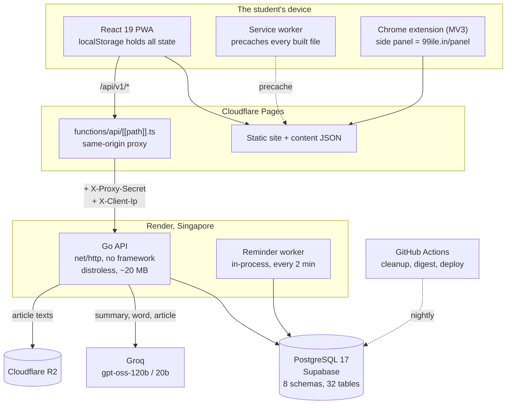
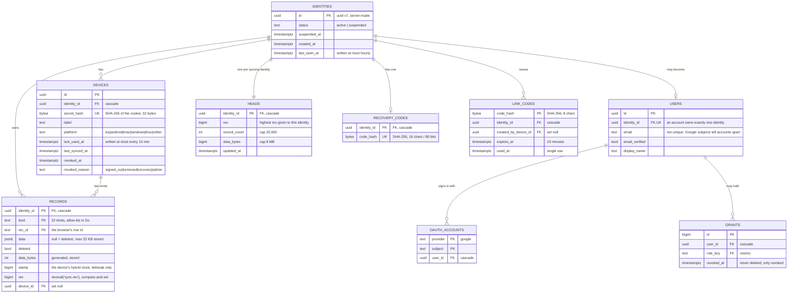
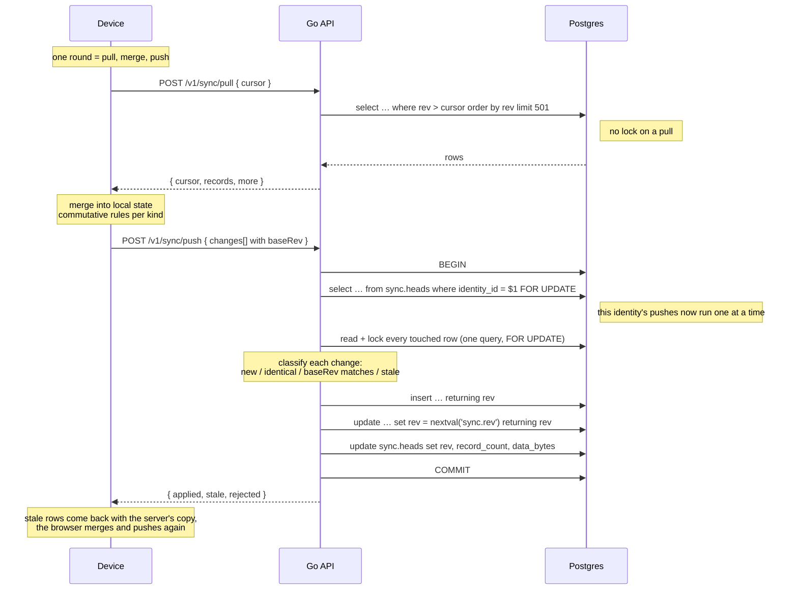
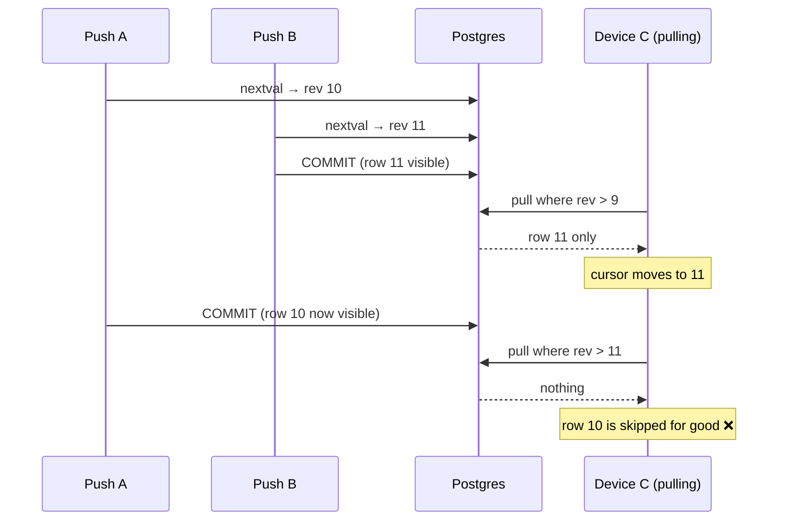
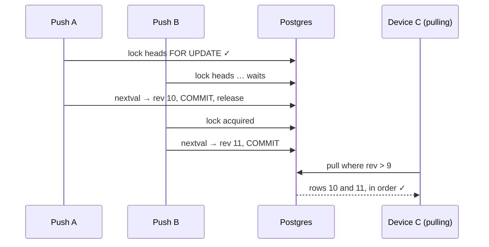

# 99ile

Source document for the case-study page. Everything here is traceable to `japp47/CAT-Prep`;
anything I could not verify from the repo is marked `TODO(jappreet)`.

- **Live:** [99ile.in](https://99ile.in) · [repo](https://github.com/japp47/CAT-Prep) · Chrome extension
- **Built and run solo**, started 17 Oct 2026, 245 commits by 20 Nov 2026
- **Stack:** Go 1.27, PostgreSQL 17, React 19, TypeScript, Vite, Cloudflare Pages, Render, Supabase, Groq

---

## 1. What it is

99ile helps students prepare for CAT, India's entrance exam for the IIMs. It plans each day around
the time the student actually has, gives exam-style practice where every wrong option is explained,
and keeps bringing their own mistakes back until they stop happening. VARC and DILR are live; Quant
lands January 2027.

The interesting part for an engineer is the constraint I set at the start: **everything works as a
guest, offline, on one device.** Sync, sign-in and AI are additions, never a gate in front of
practice. That one rule decided the architecture — content ships with the site rather than living
in the database, the browser owns the state, and the server's only real job is to order writes so
that two of a student's devices converge.

Every service runs on a free plan.

## 2. The five principles

These are from the repo's README and they are worth stating because the rest of the design falls
out of them.

1. **No sign-up to start.** Everything works as a guest, offline, on one device.
2. **Code counts, AI explains.** Scores, schedules, answer checks and recommendations come from
   tested code. AI is used only where the answer differs per student, its output is checked against
   a schema, and practice never waits for it.
3. **Original content, checked by tests.** Every answer key is tested before it ships. DILR answers
   are computed by a solver; new DI sets are solved by two independent checkers.
4. **Fast on a cheap phone on 4G.** The first download has a budget — 155 KB gzipped allowed, about
   129 KB today — enforced by CI.
5. **Free to run.** Every service is on a free plan.

## 3. Feature list

### Practice

- **Reading comprehension** — 55 sets across 9 genres, every wrong option carrying a `trap`
  annotation explaining why it tempted you (753 of them).
- **Verbal ability** — 80 paragraphs, each yielding four question types (jumble, odd-one-out,
  summary, inference).
- **Critical reasoning** — 30 questions.
- **Logical reasoning and data interpretation** — 59 sets (47 LR across 13 kinds, 12 DI), answers
  recomputed by a solver rather than typed in by hand.
- **Drills** — clue drills, must/could, first-move, speed tests, sectional mocks, arena, replay.
- **Redo** — mistakes come back until they stop happening.

### Planning and progress

- A plan built around the hours the student says they have, not a fixed syllabus calendar.
- Today view, progress, history, error log, word list, journal, week review.

### Accounts and sync

- Three levels, in order of how much the student has to give up: a **backup file**, **anonymous
  sync** across devices, then a **Google account**.
- Device linking by QR code or an 8-character code; a 16-character recovery code.
- Device list, remove a device, export everything, delete everything.

### Reminders

- Daily study reminders by web push or email, at a chosen minute, on chosen days, in the student's
  own time zone, with quiet hours and a pause.
- Streak tracking and a weekly review, with one-click unsubscribe.

### AI (four live features)

- **Summary feedback** — judges each of the four checks on the student's own 25-word summary,
  quoting their words, never rewriting. Their own ticks are deliberately not sent to the model.
- **The smallest fix** — after one revision, the minimum edit that makes all four checks pass,
  with the edit distance capped in code.
- **A word's meaning in its sentence.**
- **Article → RC set** — paste any article and get a CAT-style set out of it.

### Chrome extension

- On any article: click, right-click, or Alt+Shift+R, and the side panel turns the page into an RC
  set with the passage highlighted in place. Right-click a word to add it with its meaning in
  context.

## 4. System architecture



Three things worth calling out:

- **The proxy means there is no CORS and no third-party cookie.** The browser only ever talks to
  its own origin. The device cookie stays first-party, and the API is not reachable directly —
  it answers `503 sync_unavailable` to anything without the shared `X-Proxy-Secret`.
- **The site works with the API down.** Practice content is in the repository as JSON, loaded one
  file at a time. The proxy returns a graceful 503 that says "Your progress is safe on this device."
- **No framework on the server.** `net/http.ServeMux` behind a small router that turns ServeMux's
  plain-text 404/405 into the shared JSON error shape. Five dependencies: pgx, goose, go-oidc,
  go-jose, oauth2.

## 5. Data model

Postgres 17, no ORM, goose migrations embedded in the binary. **8 schemas, 32 tables**, one schema
per area and never `public`. Two database roles: `cat_app` (the API, cannot run DDL) and
`cat_readonly` (dashboards; column-level grants hide every secret hash and `sync.records.data`).
Migrations may only add, because the old server keeps running against the new schema during a
deploy.

### The core: identity, devices, sync



Two keys do the work:

- `sync.records` is keyed **(identity_id, kind, rec_id)** — that is the upsert key, so a device
  pushing the same row twice updates in place.
- A unique index on **(identity_id, rev)** serves the one query a pull makes:
  `where rev > $cursor order by rev limit 500`.

Staff permissions hang off `account.users`, not `account.identities`, so a stolen device cookie can
never be an admin — the foreign key enforces it.

### The rest of the schemas

| Schema    | Tables         | What it holds                                                                           |
| --------- | -------------- | --------------------------------------------------------------------------------------- |
| `app`     | —              | Two helper functions (`touch_updated_at`, `lock_out_api_roles`)                         |
| `account` | 6              | Identities, devices, recovery and link codes, users, OAuth, sign-in tickets             |
| `sync`    | 2 + 1 sequence | `heads`, `records`, `rev`                                                               |
| `audit`   | 1              | Append-only events; `cat_app` has insert and select only                                |
| `support` | 1              | Problem reports from students                                                           |
| `access`  | 4              | Roles, permissions, role_permissions, grants                                            |
| `notify`  | 8              | Prefs, push subs, activity, the message queue, days, weeks, bounces, unsubscribes       |
| `ai`      | 9              | Cache, usage, per-model usage, daily caps, flags, jobs, article texts, student articles |

Two details I like in there:

- **`audit.events` stores `ip_hash` as HMAC-SHA256 with a yearly key**, plus an `ip_key` saying
  which key. Hashes only compare within one key, so an IP cannot be tracked across years. A BRIN
  index on `created_at`, because the table is append-only and time-ordered.
- **`notify.messages` is the queue** — no Redis, no broker. Claimed with `SKIP LOCKED`, deduped by
  a unique `dedupe_key` of `identity:kind:channel:day`, so the same reminder can never go twice.

## 6. The sync protocol

The cursor is a **server-assigned revision number**, not a timestamp. Clocks on phones are wrong;
a sequence is not.



**Nothing is overwritten blind.** Every change names the `rev` it was based on. If the stored row
has moved on, the server returns it as `stale` with its current copy and the browser merges. If a
change is byte-identical to what is stored, it is reported as applied without burning a new rev —
which makes a retried push free.

**Rejections are per row, never per push:** `unknown_kind`, `bad_id`, `record_too_big`,
`over_limit`. Updates and deletions are always allowed, so a student at the 20,000-record cap can
still make room.

Limits: 500 records per pull page, 200 changes per push, 16 KB per record on the wire, a 64 KB
body cap, 120 sync calls a minute per device, 20,000 records and 8 MB per identity.

On the client (`src/lib/sync/`): a ledger in its own localStorage key, outside app state and
outside backups, holding four values per record — the hash of the data, when it changed, the last
server rev seen, and the hash the server holds. Dirty rows are where the local hash differs from
the server's. Sync runs on load, 30 seconds after the last change, on `online`, on tab hide (with
`keepalive`), and on focus if it has been more than five minutes. **No polling.** Two open tabs are
serialised with the Web Locks API.

## 7. The bug that mattered

This is the part worth reading.

`rev` comes from a Postgres sequence. **A sequence hands out numbers when it is asked, not when the
transaction commits.** So two devices of the same student pushing at the same time can commit out
of order:



Device C's cursor has passed 10 before row 10 ever became visible. It will never ask for it again.
The record is lost on that device permanently — and silently, which is worse.

**The fix is one line, first in the transaction:**

```go
err := pgx.BeginFunc(r.Context(), s.db, func(tx pgx.Tx) error {
    var head struct{ rev, count, bytes int64 }
    if err := tx.QueryRow(r.Context(),
        `select rev, record_count, data_bytes from sync.heads where identity_id = $1 for update`,
        d.IdentityID).Scan(&head.rev, &head.count, &head.bytes); err != nil {
        return fmt.Errorf("lock head: %w", err)
    }
    // …read and lock the touched rows, classify, write
})
```

Every push takes its identity's head row `FOR UPDATE` before it does anything else. One student's
pushes then run strictly one after another, so their revs become visible in the order they were
assigned:



The cost is bounded and the scope is right: the lock is per identity, so **different students never
wait for each other**, and **pulls take no lock at all**. The table comment says it in one line:
_"One row per identity. Every push locks it first, so one identity's pushes run in turn and a pull
never skips a row."_

Proven by a 40-seed property test that drives two devices through random interleavings and asserts
they converge without losing an attempt, plus Go integration tests that run concurrent pushes
against a real Postgres with `-race`.

## 8. Numbers

### Load test

A separate database seeded with **10,000 synthetic students** (2,025 of them "serious"), created the
way sign-up creates them, then an evening peak replayed through the real API with a 1 ms proxy lag
and `GOMAXPROCS=1`.

Measured footprint: **10.7 million records, 5.5 GB** (3.7 GB table, 1.8 GB indexes) — 563 KB per
student, 538 bytes per record. The JSON the browsers sent is only 1.7 GB; the rest is row and index
overhead.

Before and after moving the push to set-based writes:

|                                                         |          Before |     After |
| ------------------------------------------------------- | --------------: | --------: |
| A 200-record push (turning sync on with a long history) |        1,103 ms | **31 ms** |
| Push p95 at the expected 10k peak (12 sessions/s)       |           83 ms | **30 ms** |
| Push p95 at 150 sessions/s                              |        6,055 ms | **24 ms** |
| Saturation (connection pool of 5)                       | ~150 sessions/s |  **~250** |

250 sessions a second is about **20 times** the expected peak for 10,000 students. Targets: push
p95 under 300 ms, pull p95 under 150 ms, errors under 0.1% at three times peak.

### Front end

The October 2026 speed pass, measured on Lighthouse mobile:

|                       | Before |      After |
| --------------------- | -----: | ---------: |
| RC passage LCP        | 3.16 s | **2.06 s** |
| RC passage download   | 593 KB | **297 KB** |
| Home CLS              |  0.107 |      **0** |
| Main script (gzipped) | 131 KB | **110 KB** |

Self-hosted fonts cut from 119 KB to 49 KB by dropping the optical-size axis and italics, with
size-matched Arial and Georgia fallbacks so text does not shift. CI fails the build if the first
download goes over 155 KB gzipped.

### Tests

124 test files — 73 TypeScript (Vitest), 51 Go, of which 17 are integration tests run with `-race`
against a real Postgres 17.

> **TODO(jappreet):** the README says "about 1,600 tests". Source counting finds 587 `it(`/`test(`
> call sites in TypeScript and 189 `func Test…` in Go. The gap is real and explainable — a large
> share of cases are generated in loops over content (55 RC sets × 2 assertions, 80 VA paragraphs
> × 3, 30 CR items × 2, 59 LR/DI sets, a 40-seed property test), so Vitest counts far more at
> runtime than appear in source. `docs/analyze.md` A83 records a correction from "about 770" to
> 1,385 at an earlier point. **Can you paste the current `npm test` summary line?** The portfolio
> should quote a number you can show on demand.

## 9. Decisions and trade-offs

The repo keeps a numbered decision log (D1–D116) and finding log (A1–A147) in `docs/analyze.md`.
The ones worth a page:

**Server-assigned revisions, not timestamps (D8).** Device clocks are wrong, sometimes by hours.
A sequence gives total order for free. The device's own hybrid clock is still carried on each
record, but only as a merge tiebreak — never as the sync cursor.

**A lock per identity rather than a global one.** The alternative, serialising all pushes, would
have been simpler and would have scaled to roughly one student at a time. Locking the head row
scopes the contention to exactly the set of writes that must be ordered.

**Compare-and-set over last-write-wins.** Last-write-wins is one column and no round trips, and it
silently eats a student's answers when two devices are both open. Naming the base rev makes a
conflict visible so the browser can merge it, and the merge rules are all commutative by
construction: every rule gives the same answer whichever copy is "ours".

**Content in the repository, not the database.** Practice content is JSON files checked by tests on
every change. It means a content fix is a pull request with a test, the site works offline, and the
database stays small. The cost is that adding content needs a deploy.

**localStorage, not IndexedDB.** One string holds the whole app state. Simple, synchronous, and
fine up to a few megabytes. The scale document already plans the move to IndexedDB (one object
store per kind, writing only the records that changed, which the sync ledger already knows) for
when a serious student's history outgrows it.

**No ORM, five dependencies.** The push is two set-based SQL statements with `unnest(…) with
ordinality`. An ORM would have made that N round trips, which is exactly the 1,103 ms the load test
measured before the rewrite.

**AI only where the answer differs per student (D105).** "Explain my mistake" was built and then
deleted: its answer is the same for every student who picks that option, so it belongs in the
content as a tested annotation, not in a live model call. What survived is summary feedback, the
smallest fix, a word in its sentence, and article → RC set.

**Honest negatives, recorded.** A login cache was reverted because it broke a test that matters —
a student suspended in the database must be refused at once. Answering empty pulls from memory
showed no measured gain. Gzip in the API was dropped because Cloudflare already compresses.

## 10. What I'd do next

- Quant, January to March 2027; DI sets to 24 by mid-January.
- IndexedDB instead of one localStorage string, writing only changed records.
- Partition `sync.records` by hash of `identity_id` past about 50 million rows.
- An end-to-end Playwright suite; today the browser checks are manual, listed per branch in
  `docs/implement.md`.

---

## Open questions for the page

- `TODO(jappreet)` above: the current test count.
- **Student numbers.** There are no analytics in the repo, by choice. `docs/analyze.md` notes
  students start arriving in January 2027. Is there any usage figure you are happy to publish, or
  should the page stay silent on users and lead with the load test instead? My preference is the
  load test — it is measured, reproducible, and more interesting.
- **Which single diagram leads the page?** My pick is the sync race from section 7: it is the one
  picture that makes a reviewer stop, and the before/after toggle is a natural interaction.
