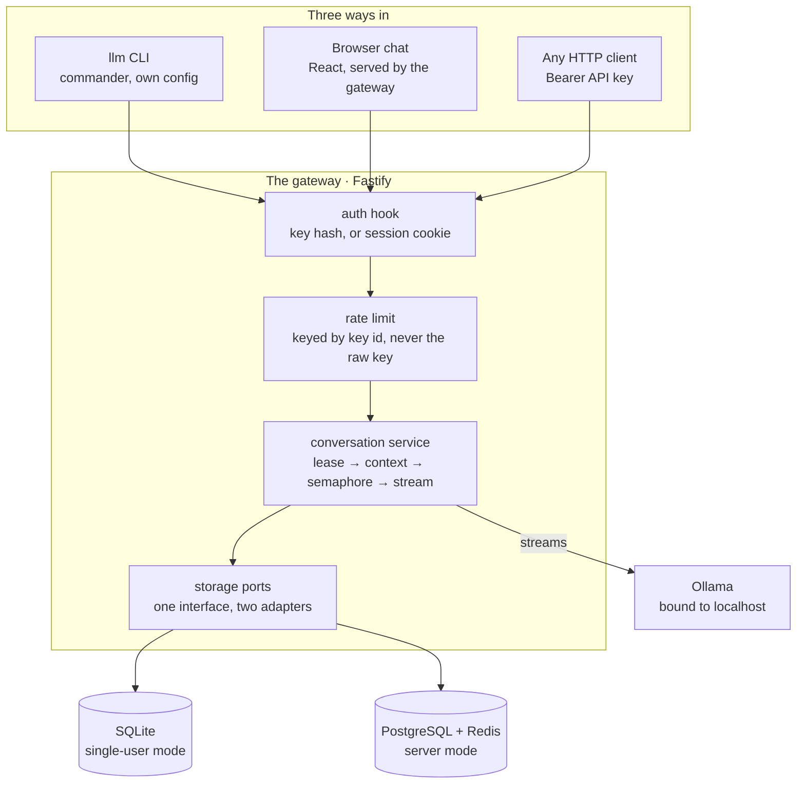
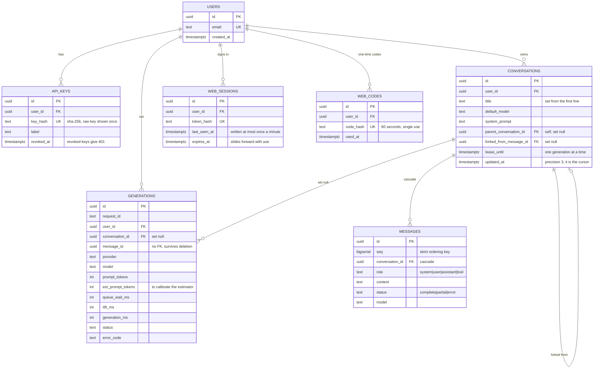
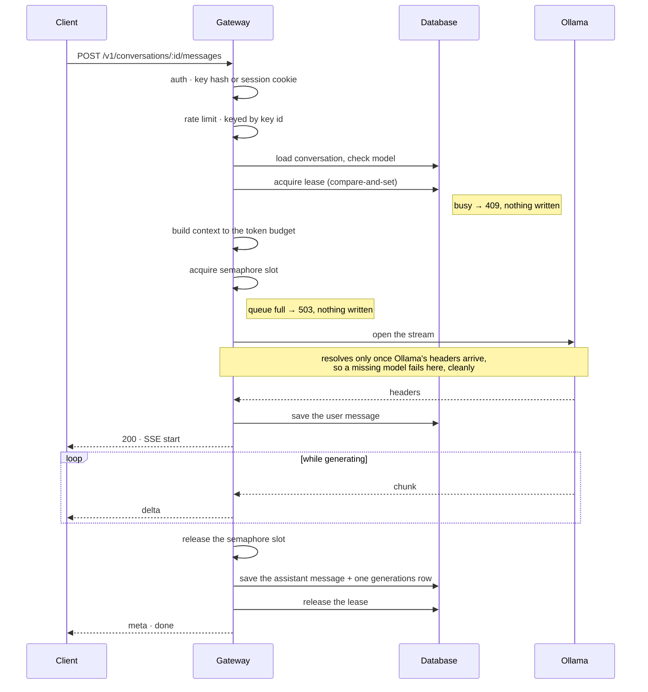

# Local LLM Gateway

Source document for the case-study page. Everything here is traceable to
`japp47/local-llm-gateway` at commit `a32ef5a`; anything I could not verify is marked
`TODO(jappreet)`.

- **npm:** `local-llm-gateway` v0.1.1 · [repo](https://github.com/japp47/local-llm-gateway) · MIT
- **Built and run solo**, 2026
- **Stack:** TypeScript, Fastify, Ollama, SQLite / PostgreSQL + Redis, React, Drizzle, Vitest

---

## 1. What it is

A private AI assistant that runs on your own computer. Your conversations never leave it.

It is a small Fastify server in front of Ollama, plus a terminal app (`llm`) and a browser chat
page. It keeps your history, picks a model that fits your machine's memory, explains problems in
plain words, and backs your chats up.

```
npm install -g local-llm-gateway
llm start
llm chat "hello"
```

No Docker, no database to set up.

The engineering interest is not the LLM part — it is everything around it. One GPU, one Ollama, and
a stream that can die halfway through. The gateway's job is to make sure that when something goes
wrong, the database is not left holding half an answer.

## 2. The constraint that shaped it

Target hardware: a MacBook Air M4 with 16 GB. Every performance claim in the repo is measured
there. That single machine is why admission control exists at all — a second concurrent generation
does not halve throughput, it pushes the model out of unified memory and falls off a cliff. So the
defaults are `MAX_CONCURRENCY=1` with a bounded queue, and the gateway's own README carries a long
explainer on quantisation, KV cache growth and why `Decode speed ≈ memory bandwidth / model size`.

The second rule: **the mode is chosen only by configuration.** `DATABASE_URL` set means server
mode; otherwise single-user mode on SQLite. Same code, same tests, two deployments.

## 3. Feature list

### The assistant

- Chat from a terminal, an HTTP API or a browser page, all against your own Ollama.
- Conversations kept, listed, renamed, resumed and deleted.
- **Forks** — branch a conversation from any message and carry on down a different path.
- A model picked automatically to fit about half your RAM, from a curated list.
- Backup and restore of every conversation.
- `llm doctor` — checks Ollama, the model and the database, and says what to do in plain words.

### The server

- Two run modes behind one storage interface: SQLite single-user, or PostgreSQL + Redis shared.
- Per-key rate limiting, Redis-backed when present, in-memory otherwise.
- One in-flight generation per conversation, enforced by a lease that expires.
- Bounded concurrency and a bounded queue over the GPU.
- Streaming over SSE with token counts and timings on every answer.
- Prometheus metrics and a per-user stats endpoint with p50/p95 by model.
- An OpenAPI 3.1 document, checked against real responses by a contract test.

### The browser page

- Sign-in by one-time code from the CLI, exchanged once for a session cookie.
- Host allow-list against DNS rebinding, Origin checks on state-changing requests, strict CSP.
- A hand-written escape-first Markdown renderer, because model output must never become HTML.

## 4. System architecture



The seam worth pointing at is `src/storage/ports.ts`. It is the whole contract between the services
and the database, and `openStorage()` is the single place that decides which adapter answers. Its
stated invariant: _every method that takes a userId is scoped by it — an id alone never grants
access._

What forced that seam into existence were three Postgres-only tricks that had to be reimplemented
for SQLite: `percentile_cont` for the stats endpoint (rewritten exactly in `src/lib/stats.ts`),
`FOR SHARE` row locks when forking a conversation (a transaction on SQLite), and `make_interval`
in the lease. The same integration suite runs against both backends, and
`test/storage-contract.int.test.ts` exists specifically for _"cases where adapters tend to
diverge."_

## 5. Data model

Seven tables, mirrored table-for-table between `src/storage/postgres/schema.ts` and
`src/storage/sqlite/schema.ts`. The SQLite differences are deliberate and documented: ids are text
UUIDs made in app code, timestamps are integer milliseconds, and `messages.seq` is the
AUTOINCREMENT primary key.



Three choices in there worth defending:

- **`conversations.updated_at` is declared `precision: 3`.** It is the keyset pagination cursor,
  paired with the id as a tie-breaker so equal timestamps are never skipped. A JS `Date` and JSON
  only carry milliseconds, so the column matches what can round-trip.
- **`generations.message_id` has no foreign key.** Deliberately loose: the operational record of
  what happened should survive the message being deleted.
- **`generations` is one row per _attempt_, not per success.** Queue wait, time to first token,
  generation time, token counts, status and error code. That is the dataset `/v1/stats` reads to
  give p50/p95 per model, for the calling user only.

## 6. A request, end to end



The SSE contract is `start → delta* → meta → done`, or `error`. `meta` carries the provider, the
model, prompt and completion tokens, whether those counts came from the provider or were estimated,
queue wait, time to first token, total time, and how many older messages were dropped to fit the
context.

## 7. The hard part: two guards, and the order of operations

This is the section worth reading.

### Two guards, because there are two different problems

A lease and a semaphore look like the same thing. They are not.

|                   | **The lease**                     | **The semaphore**                   |
| ----------------- | --------------------------------- | ----------------------------------- |
| Protects          | one conversation's correctness    | the GPU                             |
| Scope             | per conversation, in the database | per process, in memory              |
| Failure           | `409 conversation_busy`           | `503 server_busy`, `retry-after: 5` |
| Survives a crash? | yes — it expires                  | no, and it does not need to         |

The lease is a single atomic compare-and-set, so two requests racing for the same conversation
cannot both win:

```sql
update conversations
   set lease_until = now() + make_interval(secs => $2)
 where id = $1
   and (lease_until is null or lease_until < now())
returning id
```

Because it expires (`LEASE_SECONDS`, default 180), a process that dies mid-generation does not
leave a conversation locked forever.

The semaphore is about forty lines and has two details that matter. Releasing hands the slot
**directly** to the next waiter without touching `active`, so there is no window where a freed slot
could be claimed twice; and the release function is idempotent, so a double release cannot inflate
capacity:

```ts
private makeRelease() {
  let released = false;
  return () => {
    if (released) return;
    released = true;
    const next = this.waiters.shift();
    if (next) next();        // hand the slot over directly
    else this.active--;
  };
}
```

A request that is aborted while queued splices itself out of the waiter list rather than being
granted a slot nobody is waiting for.

### Open the stream before writing anything

The ordering decision is the one I would defend in an interview.

The obvious order is: save the user's message, return 200, then call the model. It is also wrong.
If Ollama is stopped, or the model was deleted, or it is too large for the machine, you have
already written a user message and already committed to a 200 — so the failure has to be reported
_inside_ the stream, and the conversation is left with a dangling message that will be sent as
context on every retry.

So the gateway opens the provider stream **first**, and only once Ollama's headers come back does
it save the user message and send the 200:

```
            ┌─ Ollama down, model missing, model too large
            │
  open ─────┴──▶ clean JSON error · nothing written · retry starts fresh
     │
     └──▶ headers ──▶ save user message ──▶ 200 SSE ──▶ stream
```

The documented cost is honest: _a cold first answer starts about 2 s later than before_, because
opening the stream waits for the model to load. That is the trade — two seconds on a cold start, in
exchange for never leaving a half-written conversation behind.

### When it dies halfway

If the stream fails after some text has arrived, the accumulated text is saved with
`status: 'partial'`, the error code goes into the `generations` row, and the client still gets
`meta` and `done`. Error-status messages are filtered out of future context, so a failed answer
never poisons the next one. A client that simply disconnects gets no `error` event at all.

Provider failures are a closed taxonomy — `ollama_unavailable`, `model_not_installed`,
`model_too_large`, `model_stopped`, `provider_error` — classified where Ollama's responses are
parsed and mapped to HTTP one layer up. The detail string is marked _for logs only: never shown to
users_.

`TODO(jappreet):` the repo notes one gap — a hard crash, as opposed to a dropped connection, still
loses in-flight text. The plan is to checkpoint a `streaming` row every few seconds and mark stale
ones `partial` on startup. Worth saying out loud on the page, or leave it for the roadmap section?

## 8. Numbers

|                                                             |                                       |
| ----------------------------------------------------------- | ------------------------------------: |
| End-to-end checks against a real Ollama, both modes         |                               **155** |
| Unit test cases                                             |                                    74 |
| Integration test cases, run against Postgres **and** SQLite |                                    83 |
| CLI test cases                                              |                                    88 |
| Browser page test cases                                     |                                     9 |
| Default concurrency / queue                                 |                                 1 / 8 |
| Default context budget                                      | 4,096 tokens, 800 reserved for output |

`scripts/e2e.sh` is a hand-rolled bash harness, not Vitest. It builds the gateway, boots it twice —
single-user on one port with a temporary data directory, server mode on another against Postgres
and Redis — and runs a shared block of checks against both: health and mode, the OpenAPI document,
auth failures, the SSE event order, forks, stats, doctor, backup and browser sign-in. That shared
block running once per mode is where 155 comes from.

CI runs three jobs: `server` (Postgres 16 + Redis 7, typecheck, build, CLI checks, unit and
integration), `sqlite` (the same integration suite with no services at all), and `package` (a pack
smoke test). It does **not** run the e2e script, because that needs a real Ollama.

`TODO(jappreet):` the roadmap self-reports "86 gateway unit, 64 integration, 87 CLI". My counts
above are from the current source. Which do you want on the page?

## 9. Decisions and trade-offs

**Two backends behind one interface, not two codebases.** SQLite means a new user runs one command
and has a working assistant with no Docker and no database. Postgres means a shared one. The cost
is a storage port that every feature has to be expressed through, and the discipline of running the
whole integration suite twice.

**Admission control in-process, in both modes.** A distributed limiter would be correct for many
servers; there is one GPU, so the honest unit is the process that owns it.

**A heuristic token counter, behind an interface.** Three characters per token, _deliberately
pessimistic so we under-fill the context window_, plus four tokens per message for role markers.
The real count from the provider is stored next to the estimate in `generations` precisely so the
estimator can be calibrated from data later. `meta` tells the client which it got.

**Request ids generated server-side.** `'req_' + randomBytes(6)`, with the comment _never trust
client-supplied ids_. Echoed in every error body and in `x-request-id` — set manually on streaming
replies, because a hijacked response skips Fastify's normal hook.

**A single-instance lock, postmaster-style.** An atomic `open(path, 'wx')`, the pid inside, a
liveness check that treats `EPERM` as alive, stale locks taken over, and release only if the file
still names this process. Its error message is _a sentence the user can act on, not a stack trace_.

**The CLI refuses to send a saved key to the wrong gateway.** If `LLM_BASE_URL` points somewhere
other than the saved profile and no key was given for it, the saved key is deliberately withheld.
Zero-config local pickup reads a credentials file only if it is owned by the current user and not
readable by anyone else — _a key others can read is not a secret_.

**A competitor was researched and the conclusion written down.** LiteLLM already does gateway
features — rate limits, budgets, key management — so the roadmap records that server mode must not
be sold on those, and that LiteLLM should instead be considered as one adapter behind the provider
interface.

## 10. What's next

From the roadmap, in order: phone access (a switch that is off by default, QR pairing with one
revocable key per device, HTTPS over Tailscale), then whichever wedge the customer interviews
point at. Further out: session recovery for the crash case above, privacy modes enforced
server-side and failing closed, documents and memory, and tools over MCP with a permission prompt
on every call.

---

## Open questions for the page

- `TODO(jappreet)` ×2 above: which test numbers to publish, and whether to state the crash-loses-
  in-flight-text gap on the page. My instinct is yes — naming a known limitation reads as
  confidence, and it is already in your repo.
- **The page currently has no "live" link**, since this is a package rather than a site. I would
  lead the hero with the npm install line instead of a URL. Agree?
- **Which figures lead the hero?** My pick: `155` e2e checks against a real Ollama, `2` backends
  from one test suite, `1` GPU as the thing the whole design protects. That last one is a bit cute
  — say the word and I will use the context budget or the test total instead.
